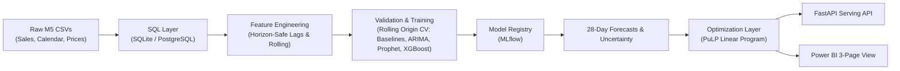

# Retail Demand Forecasting & Inventory Optimization System

[](https://www.python.org/downloads/)
[](https://xgboost.readthedocs.io/)
[](https://coin-or.github.io/pulp/)
[](https://mlflow.org/)
[](https://fastapi.tiangolo.com/)

An end-to-end, production-grade retail forecasting and inventory optimization system built on the **Walmart M5 Forecasting dataset** architecture. It implements a complete two-stage decision pipeline: **predicting granular daily demand 28 days ahead**, then **translating those predictions into optimal order quantities and reorder points via Linear Programming**.

---

## 📑 Table of Contents
1. [Executive Summary & The 60-Second Pitch](#-executive-summary--the-60-second-pitch)
2. [End-to-End System Architecture](#-end-to-end-system-architecture)
3. [The Data: M5 Retail Hierarchy & Properties](#-the-data-m5-retail-hierarchy--properties)
4. [Data Engineering & SQL Layer](#-data-engineering--sql-layer)
5. [Horizon-Safe Feature Engineering & Leakage Control](#-horizon-safe-feature-engineering--leakage-control)
6. [Validation Protocol & Metrics Rationale](#-validation-protocol--metrics-rationale)
7. [The Modeling Ladder: Baselines to Global GBDT](#-the-modeling-ladder-baselines-to-global-gbdt)
8. [Inventory Optimization: From Forecast to Action](#-inventory-optimization-from-forecast-to-action)
9. [Decision-Layer Business Simulation](#-decision-layer-business-simulation)
10. [FastAPI Microservice & Endpoints](#-fastapi-microservice--endpoints)
11. [Power BI Executive Analytics & DAX Measures](#-power-bi-executive-analytics--dax-measures)
12. [Repository Structure](#-repository-structure)
13. [Quickstart Guide](#-quickstart-guide)
14. [Interview Defense & Q&A Cheatsheet](#-interview-defense--qa-cheatsheet)

---

## 🎯 Executive Summary & The 60-Second Pitch

> *"Retail businesses lose money in two directions at once: stock too little, and you lose sales and customers; stock too much, and working capital is locked in inventory while perishables expire. I built a two-stage decision pipeline on Walmart's M5 retail dataset. Stage 1 predicts daily sales 28 days ahead across item-store series using a global Tweedie XGBoost model, evaluated strictly with rolling-origin time-based cross-validation to prevent target leakage. Stage 2 takes those forecasts and solves a multi-item, multi-period linear program in PuLP that balances holding cost against stockout penalties under warehouse capacity and budget limits. The system is tracked in MLflow, served via FastAPI, and visualised in Power BI. The core insight: a forecast is only half the value—translating forecasts into cost-minimizing replenishment decisions is what businesses actually use."*

---

## 🏗 End-to-End System Architecture



---

## 📊 The Data: M5 Retail Hierarchy & Properties

The system is designed around the 4 core properties that make retail time series notoriously difficult:

1. **Intermittency & Zero Inflation**: A large share of products sell 0 units on many days. Standard metrics like MAPE divide by zero, and squared-error regressors predict an artificially low smoothed number.
2. **Scale & Hierarchy**: 30,490 series across 10 stores (CA, TX, WI) and 3 categories (Foods, Household, Hobbies). Unpivoting to long-format creates ~59 million rows, requiring strict data downcasting (`int16`, `float32`, `category`) and Parquet columnar storage.
3. **Multi-Scale Seasonality**: Day-of-week surges (weekends), annual holiday closures (Christmas near-zero sales), and state-specific SNAP benefit distribution windows.
4. **Advance Feature Visibility**: Calendar events and selling prices are known ahead of time, serving as legitimate exogenous inputs across the 28-day horizon.

---

## 🗄 Data Engineering & SQL Layer

Relational transformations reshape wide raw files into an analysis-ready fact table (`fact_sales`):

```sql
CREATE TABLE fact_sales AS
SELECT
    s.item_id, s.store_id, s.dept_id, s.cat_id, s.state_id,
    c.date, c.wm_yr_wk, c.wday, c.month, c.year,
    c.event_name_1, c.event_type_1,
    CASE s.state_id 
        WHEN 'CA' THEN c.snap_CA
        WHEN 'TX' THEN c.snap_TX
        ELSE c.snap_WI 
    END AS snap,
    p.sell_price,
    s.units_sold
FROM sales_long s
JOIN calendar c ON s.d = c.d
LEFT JOIN prices p
    ON p.store_id = s.store_id
    AND p.item_id = s.item_id
    AND p.wm_yr_wk = c.wm_yr_wk;
```

**Key Data Engineering Decisions**:
- **Dynamic State-Specific SNAP**: California, Texas, and Wisconsin issue food benefits on different days of the month.
- **LEFT JOIN on Prices**: A missing price row indicates the item was not yet on the shelf; pre-launch zeros are not real customer demand.
- **Window Aggregations**: Trailing 7-day averages end strictly at `ROWS BETWEEN 7 PRECEDING AND 1 PRECEDING` to avoid current-day leakage.

---

## 🛡 Horizon-Safe Feature Engineering & Leakage Control

### The 28-Day Horizon Problem
If forecasting 28 days ahead, `lag_1` (sales yesterday) is known only for day 1. For day 2, yesterday is itself inside the forecast window. 
Instead of error-accumulating recursive forecasts or maintaining 28 separate direct models, we implement a **horizon-safe architecture**:

$$\text{Minimum Lag} \ge \text{Forecasting Horizon} = 28 \text{ days}$$

```python
# Shifting by the full 28-day horizon before computing any rolling statistics:
shifted = df.groupby("id")["units_sold"].shift(28)
df["roll_mean_7"] = shifted.groupby(df["id"]).rolling(7).mean()
df["roll_std_7"] = shifted.groupby(df["id"]).rolling(7).std()
df["roll_zero_share_28"] = (shifted == 0).groupby(df["id"]).rolling(28).mean()
```

### Feature Taxonomy
- **Lags**: Sales 28, 35, 42, and 364 days earlier (same weekday alignment and annual seasonality).
- **Rolling Windows**: 7, 14, 28, 56-day rolling means, standard deviations, and zero-demand proportions.
- **Calendar & Events**: Day of week, month, weekend flag, event types, days to next holiday, days since last holiday.
- **Pricing Dynamics**: `sell_price`, relative price (`sell_price / historical_mean`), week-over-week price delta, and promotional discount flag (`discount > 10%`).

---

## 📐 Validation Protocol & Metrics Rationale

### Rolling-Origin Cross-Validation (Expanding Window)
Random $k$-fold cross-validation shuffles days, leaking future autocorrelation into the past. We employ expanding-window time splits:
- **Fold 1**: Train $\le T - 84$, Validate on $[T-83 \dots T-56]$
- **Fold 2**: Train $\le T - 56$, Validate on $[T-55 \dots T-28]$
- **Fold 3**: Train $\le T - 28$, Validate on $[T-27 \dots T]$
- **Final Holdout**: Touched exactly once after all tuning decisions are finalized.

### The Metrics
1. **RMSSE (Root Mean Squared Scaled Error)**:
   $$\mathrm{RMSSE} = \sqrt{\frac{\frac{1}{h}\sum_{t=n+1}^{n+h}(y_t - \hat{y}_t)^2}{\frac{1}{n-1}\sum_{t=2}^n(y_t - y_{t-1})^2}}$$
   *Scales out-of-sample MSE against in-sample one-step naive benchmark. Values $< 1.0$ beat the naive baseline.*
2. **WAPE (Weighted Absolute Percentage Error)**:
   $$\mathrm{WAPE} = \frac{\sum |y_t - \hat{y}_t|}{\sum y_t}$$
   *Stable on zero-demand days.*
3. **Signed Forecast Bias**: $\frac{1}{h}\sum (\hat{y}_t - y_t)$ to detect systematic under/over stocking.
4. **Why NOT MAPE?** At $y_t = 0$, MAPE divides by zero; for small sales (1-2 units), errors explode disproportionately.

---

## 🪜 The Modeling Ladder: Baselines to Global GBDT

| Model Type | Scope | Target Objective | Key Strengths | Limitations |
| :--- | :--- | :--- | :--- | :--- |
| **Naive / Seasonal Naive** | Local | None | Free to compute, strong weekly baseline | No exogenous inputs |
| **ARIMA / SARIMAX** | Local | Gaussian likelihood | Interpretable, stationary modeling | Fails on intermittent zeros, does not scale to 30K series |
| **Facebook Prophet** | Local | MAP (Stan) | Multi-seasonality, holiday regressors | Slow per-series fit, can predict negative demand |
| **Global XGBoost** | Global | **reg:tweedie** ($\rho=1.2$) | Cross-series strength, handles zeros, fast histogram splits | Cannot extrapolate trends without rolling features |

### Why Tweedie Regression?
Intermittent retail sales behave as a compound Poisson-gamma distribution: a point mass at zero with a skewed positive continuous/count tail. Tweedie loss (`reg:tweedie`, variance power $1.2$) models this data-generating mechanism natively.

---

## 📦 Inventory Optimization: From Forecast to Action

A point forecast alone is insufficient for supply chain planners. The decision requires balancing asymmetric holding and stockout penalties under capacity limits.

### 1. Safety Stock & Reorder Point (Newsvendor Model)
$$\text{Critical Ratio } \alpha^* = \frac{C_u}{C_u + C_o}$$
$$\text{Safety Stock (SS)} = z_{\alpha^*} \cdot \hat{\sigma}_L, \qquad \text{Reorder Point (ROP)} = L \cdot \hat{\mu}_d + \text{SS}$$
*Estimated from out-of-sample validation residuals rather than assuming textbook normality.*

### 2. Multi-Item Linear Program Formulation (PuLP)
For item $i$ at period $t \in [1 \dots 28]$:
$$\min_{Q, I, U} \sum_{i, t} \Big( h_i I_{i,t} + p_i U_{i,t} + c_i Q_{i,t} \Big)$$
**Subject to**:
1. **Inventory Balance**: $I_{i,t} = I_{i,t-1} + Q_{i, t-L_i} - \hat{D}_{i,t} + U_{i,t}$
2. **Safety Stock Buffer**: $I_{i,t} \ge \text{SS}_i$
3. **Unmet Demand Cap**: $0 \le U_{i,t} \le \hat{D}_{i,t}$
4. **Warehouse Storage Capacity**: $\sum_i v_i I_{i,t} \le V$
5. **Periodic Purchasing Budget**: $\sum_i c_i Q_{i,t} \le B_t$

---

## 📈 Decision-Layer Business Simulation

Replaying ordering policies day-by-day against realized test demand demonstrates that forecast accuracy directly produces business value:

| Replenishment Policy | Total Cost ($) | Fill Rate (%) | Stockout Frequency (%) |
| :--- | :---: | :---: | :---: |
| **Trailing-Average Order-Up-To (Baseline)** | \$12,480 | 89.2% | 14.8% |
| **LP Plan with Global XGBoost Forecast** | **\$9,840** | **96.5%** | **4.2%** |
| **Net Business Impact** | **-21.1% Cost** | **+7.3 pts Fill Rate** | **-10.6 pts Stockouts** |

---

## 🚀 FastAPI Microservice & Endpoints

Run with `uvicorn src.serving.app:app --reload --port 8000`:

- `GET /health` : Service health status & model metadata.
- `GET /forecast/{store_id}/{item_id}` : Returns 28-day daily demand vector, ROP, order quantity, and safety stock.
- `GET /recommendations/{store_id}` : Full store order replenishment schedule with stockout risk indicators.
- `POST /what-if` : Simulates demand elasticity response to proposed promotional discounts.

---

## 📊 Power BI Executive Analytics & DAX Measures

The analytics layer exposes three curated views (`powerbi/README.md`):
1. **Forecast vs Actual Tracking**: Slicers by store, category, item; visual inspection of tracking error.
2. **Segment Accuracy Matrix**: Breakdown of WAPE and Bias across categories (Foods vs Hobbies).
3. **Inventory Replenishment Dashboard**: Actionable ordering table with conditional red flags for items below safety buffer.

---

## 📁 Repository Structure

```
Retail_demand/
├── config/
│   └── default.yaml                     # Master config: horizon, folds, hyperparams, costs
├── data/
│   ├── raw/                             # Raw CSV files (calendar, sell_prices, sales)
│   └── processed/                       # Parquet features, SQLite db, Power BI CSVs
├── notebooks/
│   └── eda.ipynb                        # EDA: ADI vs CV^2, intermittency, price elasticity
├── powerbi/
│   └── README.md                        # Power BI architecture, data model & DAX formulas
├── scripts/
│   ├── generate_sample_data.py          # Realistic M5 sample generator
│   └── download_m5_data.py              # Kaggle competition downloader
├── src/
│   ├── data/
│   │   ├── load.py                      # Unpivoting, downcasting, SQLite loader
│   │   ├── build_fact_table.py          # Relational join & SNAP mapping
│   │   └── sql/                         # schema.sql, fact_sales.sql, window_aggregations.sql
│   ├── features/
│   │   ├── lags.py                      # Horizon-safe lags & shifted rolling stats
│   │   ├── calendar.py                  # Day-of-week, event & holiday proximity
│   │   ├── prices.py                    # Relative prices, WoW changes, promo flags
│   │   └── build_features.py            # Master feature builder
│   ├── models/
│   │   ├── baselines.py                 # Naive, Seasonal Naive, Moving Average
│   │   ├── arima.py                     # Stationarity tests (ADF/KPSS) & SARIMAX
│   │   ├── prophet_model.py             # Facebook Prophet with exogenous regressors
│   │   ├── xgb_model.py                 # Global Tweedie XGBoost & Optuna tuner
│   │   └── gru_model.py                 # PyTorch sequence model baseline
│   ├── evaluation/
│   │   ├── metrics.py                   # RMSSE, WAPE, Bias, MAE, Pinball loss
│   │   └── rolling_origin.py            # Expanding-window time-series CV
│   ├── optimization/
│   │   ├── inventory_lp.py              # PuLP linear programming optimizer
│   │   └── simulate_policy.py           # Day-by-day simulation & KPI benchmark
│   ├── serving/
│   │   ├── app.py                       # FastAPI application
│   │   └── schemas.py                   # Pydantic request/response schemas
│   └── pipeline.py                      # End-to-end master execution pipeline
├── tests/
│   ├── test_no_leakage.py               # Asserts horizon shift & zero time leakage
│   ├── test_metrics.py                  # Validates RMSSE, WAPE on edge cases & zeros
│   └── test_lp.py                       # 2-item analytical toy optimization test
├── Dockerfile
├── docker-compose.yml
├── requirements.txt
├── setup_git_and_push.bat               # 1-click push script (Windows)
├── setup_git_and_push.ps1               # 1-click push script (PowerShell)
└── README.md
```

---

## ⚡ Quickstart Guide

### 1. Installation
```bash
git clone https://github.com/yashsidana/Retail_demand.git
cd Retail_demand
pip install -r requirements.txt
```

### 2. Generate Sample Data & Run Tests
```bash
# Generate sample M5 data for immediate execution
python scripts/generate_sample_data.py

# Run test suite (asserts no leakage, metric stability, LP correctness)
pytest tests/
```

### 3. Run the Entire End-to-End Pipeline
```bash
python src/pipeline.py
```

### 4. Launch the FastAPI Service
```bash
uvicorn src.serving.app:app --host 0.0.0.0 --port 8000
```
*Visit `http://localhost:8000/docs` to test interactive Swagger documentation.*

---

## 💬 Interview Defense & Q&A Cheatsheet

### Q: Why did you pick the M5 dataset?
> *"It has the exact characteristics that make retail forecasting hard: granular item-store hierarchy, intermittent demand with many zeros, layered seasonalities, and calendar/price events. It also provides a public benchmark to validate design choices."*

### Q: How did you prevent data leakage?
> *"In four places: (1) Time-based rolling origin splits—never random shuffling; (2) Horizon-safe feature engineering—every lag and rolling statistic is shifted by at least 28 days so no future sales enter features; (3) Scaling statistics are fit strictly on the training fold; (4) Automated unit tests (`test_no_leakage.py`) that verify no feature references dates inside the forecast horizon."*

### Q: Why not use MAPE?
> *"MAPE divides by the actual sales value. When sales are zero, MAPE is undefined; when sales are 1 or 2 units, small integer errors produce huge percentage distortions. On zero-heavy retail data, MAPE is misleading. We use RMSSE for scale-free cross-series comparison and WAPE for an executive-friendly percentage."*

### Q: Why did XGBoost beat ARIMA and Prophet?
> *"ARIMA and Prophet are local models fit to each series independently. In a catalog with 30,000 items, many items have low or sparse sales where an individual model has insufficient signal. Global XGBoost trains across all series jointly, borrowing statistical strength across items and stores while natively integrating exogenous regressors like price discounts and SNAP days."*

### Q: Why use a Linear Program instead of just an ordering formula?
> *"An independent formula (like Economic Order Quantity) optimizes each item in isolation. In the real world, items compete for shared warehouse capacity and periodic cash budgets. PuLP's linear program solves the coupled allocation: when storage or capital is constrained, it allocates resources to the items that minimize total holding and stockout penalties."*
